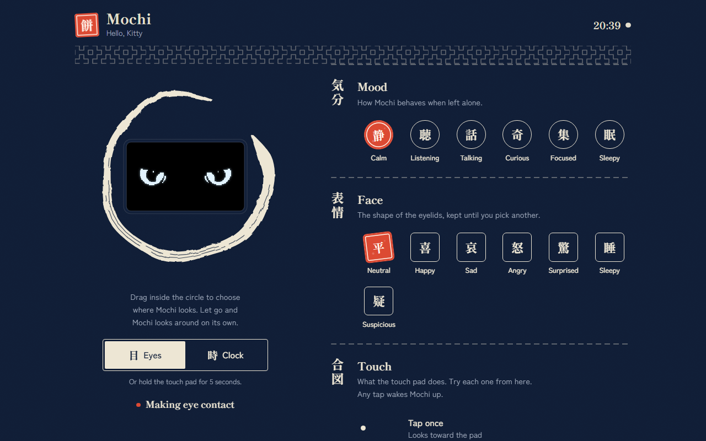
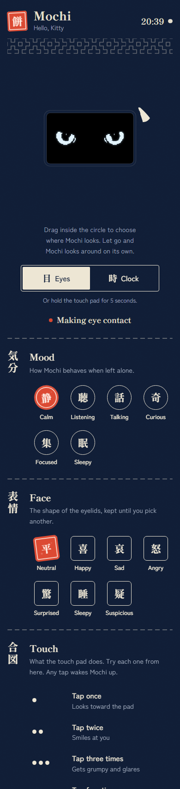
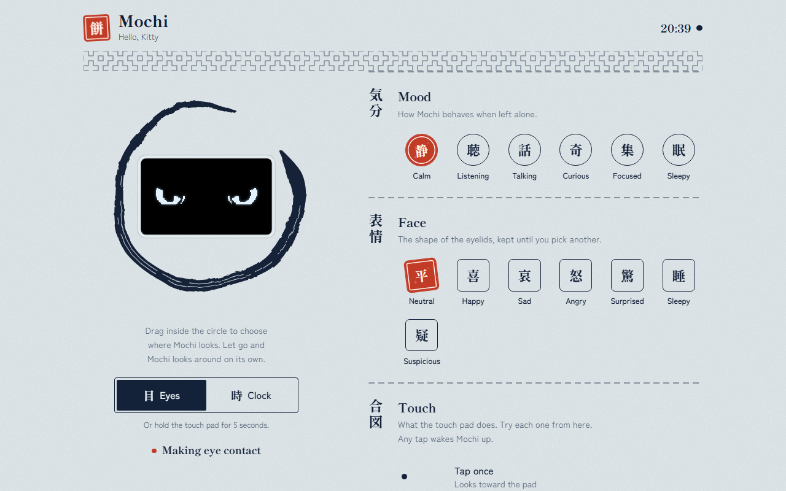
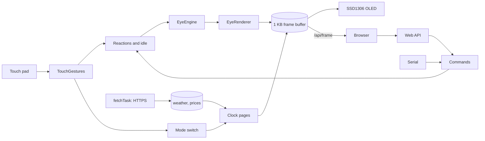

<div align="center">


# MochiEyes

**A desk companion for the ESP32-C3: lifelike eyes that react to touch, and a clock, weather and prices terminal, on one 128×64 OLED.**

[](https://github.com/satyaidk/MochiEyes/actions/workflows/ci.yml)
[](docs/HARDWARE.md)
[](https://github.com/espressif/arduino-esp32)
[](tests/host/test_touch.cpp)
[-100%25-2f6f4f)](docs/adr/0005-arduino-free-touch-gesture-recognizer.md)
[](LICENSE)

[Getting started](#getting-started) · [Usage](#usage) · [Architecture](#architecture) · [Design](docs/DESIGN.md) · [API](docs/API.md) · [Learning path](docs/LEARNING_PATH.md)


<sub>Frames rendered by the firmware's own eye engine (<code>tools/preview/frames.cpp</code>), shown at 3× scale.</sub>

</div>

## Overview

MochiEyes turns an ESP32-C3 SuperMini, an SSD1306 OLED, a touch pad and a
buzzer into a small character that lives on a desk. Most of the time the
screen shows a pair of eyes driven by a behaviour engine modelled on human eye
movement data: saccades, blinks, microsaccades and moods. Touch the pad and
the eyes respond. Hold it for five seconds and the screen slides over to a
clock with weather, crypto prices and a note you write from your phone.

The firmware merges two earlier programs, an info terminal and an eyes-only
sketch, into one. A Japanese-styled web controller lets you steer the gaze,
set the mood and watch a live copy of the OLED from any browser on the same
network.

## Key features

- **Touch reactions.** 1 tap: glances toward the pad. 2 taps: smiles.
  3 taps: grumpy side-eye. 4 or more: dizzy, with the eyes orbiting in opposite
  directions. Hold: enjoys being petted. Hold 5 s: switch faces.
- **Two faces, one screen.** Eyes and clock pages, switched with a shoji-door
  transition and an on-screen hold progress bar.
- **Alive while busy.** HTTPS downloads run in a FreeRTOS task, so the eyes
  never freeze during network requests.
- **Auto-sleep.** Drowsy after 2 minutes alone, asleep after 5; any tap wakes
  it up.
- **Web controller.** Ensō gaze pad, mood and face seals, touch-gesture tester,
  clock pages, note editor, settings and live status, in light and dark themes.
- **Live OLED mirror.** The browser shows the device's actual frame buffer,
  even when no OLED is connected.
- **One command language** for the web page, the Serial Monitor and scripts
  ([API](docs/API.md)).
- **Fits the C3.** 68% of a 1.9 MB app partition, 14% of RAM for globals.

## Demo

<table>
  <tr>
    <td width="70%"></td>
    <td width="30%" rowspan="2"></td>
  </tr>
  <tr>
    <td></td>
  </tr>
</table>

Screenshots of the real page served by `tools/preview/serve.py`, with the
mirror playing frames from the eye engine. On the device, the same page is
served from flash at `http://mochi.local`.

## Architecture



| Layer | Where | Notes |
| ----- | ----- | ----- |
| Eye behaviour and drawing | `src/eye/` | Arduino-free C++; also runs on a PC |
| Touch gestures | `src/touch/` | Arduino-free, unit-tested |
| Controller page | `web/index.html` → `src/web/WebUi.h` | Embedded gzipped |
| Hardware, modes, network, web API | `MochiEyes.ino` | The application, in one file |

The loop task owns the display, touch, engine and web server; a second
FreeRTOS task does the HTTPS requests and hands results over through a mutex.
Details: [docs/DESIGN.md](docs/DESIGN.md).

## Getting started

### Prerequisites

- ESP32-C3 SuperMini (or any ESP32-C3 with 4 MB flash), SSD1306 128×64 I2C
  OLED, TTP223 touch module, passive buzzer. Wiring: [docs/HARDWARE.md](docs/HARDWARE.md).
- Arduino IDE 2.x with **esp32 by Espressif 3.3.12**
  (Boards Manager URL `https://espressif.github.io/arduino-esp32/package_esp32_index.json`).
- Libraries (Library Manager): **Adafruit SSD1306** 2.5.17,
  **Adafruit GFX Library** 1.12.6, **ArduinoJson** 7.4.3.

### Install

```sh
git clone https://github.com/satyaidk/MochiEyes.git
```

The folder must stay named `MochiEyes`, matching `MochiEyes.ino`.

### Configure

1. Copy `secrets.example.h` to `secrets.h` and set your 2.4 GHz Wi-Fi name and
   password. `secrets.h` is git-ignored.
2. Optional, at the top of `MochiEyes.ino`: `TZ_STRING` (time zone),
   `OWNER_NAME` (greeting), `TOUCH_SIDE` (`-1` if the pad is on the left as
   you face the screen, `+1` if on the right).

### Run

In **Tools**, set:

| Setting | Value |
| ------- | ----- |
| Board | ESP32C3 Dev Module |
| USB CDC On Boot | **Enabled** |
| Partition Scheme | **Minimal SPIFFS (1.9MB APP with OTA/128KB SPIFFS)** |

The partition setting is required: the firmware does not fit the default
1.2 MB app partition ([ADR 0004](docs/adr/0004-minimal-spiffs-partition.md)).
Then **Upload**.

Or from the command line:

```sh
arduino-cli compile --upload -p COM5 \
  --fqbn esp32:esp32:esp32c3:CDCOnBoot=cdc,PartitionScheme=min_spiffs .
```

On boot you hear one beep (alive), a second (OLED found) and a high beep
(Wi-Fi joined). The eyes open and the bottom of the screen shows the IP
address. If Wi-Fi fails, the device opens a hotspot named **Kitty**
(password in `secrets.h`); join it and browse to `http://192.168.4.1`.

## Usage

### On the device

| Gesture | Eyes | Clock |
| ------- | ---- | ----- |
| Tap | Glance toward the pad | Next page |
| Tap twice | Smile | Previous page |
| Tap three times | Grumpy | Clock face |
| Tap four times | Dizzy | Clock face |
| Hold | Petting | Hold 1.5 s and let go: refresh data |
| Hold 5 s | Switch to clock | Switch to eyes |

### From a browser

Open `http://mochi.local` (or the IP shown at boot). Drag inside the ensō to
point the gaze; let go and Mochi looks around on its own. Choose a mood or a
face, try the touch gestures, pick a clock page, send a note, and change
settings. Settings are saved on the device.

### From scripts or the Serial Monitor

```sh
curl -d "cmd=mood curious" http://mochi.local/api/eye
curl -d "cmd=gesture 2"    http://mochi.local/api/eye
curl -d "m=clock"          http://mochi.local/api/mode
curl http://mochi.local/api/state
```

The same commands work in the Serial Monitor at 115200 baud (type `help`).
Full reference: [docs/API.md](docs/API.md).

## Project structure

```
MochiEyes/
├── MochiEyes.ino            # the application: hardware, modes, reactions, network, web API
├── secrets.example.h        # credential template (copy to secrets.h)
├── src/
│   ├── eye/                 # eye engine: behaviour, geometry, renderer, text commands
│   ├── touch/
│   │   └── TouchGestures.h  # tap / hold / 5 s hold recognizer
│   └── web/
│       └── WebUi.h          # GENERATED: gzipped web/index.html
├── web/
│   └── index.html           # the controller page (edit this)
├── tests/host/
│   └── test_touch.cpp       # host unit tests for the gesture recognizer
├── tools/
│   ├── embed_web.py         # web/index.html -> src/web/WebUi.h (and --check)
│   └── preview/
│       ├── frames.cpp       # run the eye engine on a PC, write raw frames
│       ├── make_gif.py      # frames -> animated GIF
│       └── serve.py         # preview the page with a mock API
├── docs/                    # design doc, API, hardware, learning path, ADRs, images
└── .github/                 # CI workflow, issue and pull request templates
```

## Testing & quality

| Check | How | Result |
| ----- | --- | ------ |
| Firmware compiles, all warnings on | `arduino-cli compile --clean --warnings all` (CI and local) | 0 warnings |
| Touch gesture logic | `tests/host/test_touch.cpp`, `-Wall -Wextra -Werror` | 44 checks, 0 failures |
| Coverage of `src/touch/TouchGestures.h` | gcov in CI | 100% of lines (40/40) |
| Eye engine on a PC | `tools/preview/frames.cpp` builds and renders | 600 frames rendered for the demo GIF |
| Embedded page matches source | `python tools/embed_web.py --check` | Enforced in CI |
| Builds without `secrets.h` | CI compiles from `secrets.example.h` only | Enforced in CI |

Run the host tests locally:

```sh
cd tests/host
g++ -std=c++11 -Wall -Wextra -Werror -I../.. test_touch.cpp -o test_touch && ./test_touch
```

Coverage covers the touch module only. The rest of the firmware is verified
by compiling and on hardware.

## Evaluation

All numbers measured with arduino-cli and esp32 core 3.3.12 for `esp32c3`
with USB CDC on boot enabled.

**Flash and RAM**

| Build | Partition | Flash | RAM (globals) |
| ----- | --------- | ----- | ------------- |
| Original `clock.ino` | Default (1,310,720 B) | 1,274,489 B (97%) | 41,952 B (12%) |
| Original eyes-only sketch (U8g2) | Default | 378,334 B (28%) | 21,964 B (6%) |
| **MochiEyes 1.0.0** | Default | 1,351,143 B (103%): does not fit | 47,648 B |
| **MochiEyes 1.0.0** | Minimal SPIFFS (1,966,080 B) | **1,351,175 B (68%)** | **47,648 B (14%)** |

**Web page**

| Item | Size |
| ---- | ---- |
| `web/index.html` | 39,339 bytes |
| Embedded in flash (gzip level 9) | 13,238 bytes (34%) |

**Not yet measured on hardware.** Frame rate, free heap and the fetch task's
stack headroom are reported live by the device (`/api/state` → `sys`, and the
Status panel), but no recorded values are published here yet. The upper bound
on frame rate is set by I2C: one 1 KB frame needs about 23 ms on the wire at
400 kHz.

## Design decisions

| ADR | Decision |
| --- | -------- |
| [0001](docs/adr/0001-merge-into-one-firmware.md) | Merge the clock and the eyes into one firmware |
| [0002](docs/adr/0002-one-display-library-shared-frame-buffer.md) | One display library, one shared frame buffer |
| [0003](docs/adr/0003-network-fetches-in-a-freertos-task.md) | Network fetches run in a FreeRTOS task |
| [0004](docs/adr/0004-minimal-spiffs-partition.md) | Use the Minimal SPIFFS partition scheme |
| [0005](docs/adr/0005-arduino-free-touch-gesture-recognizer.md) | An Arduino-free, unit-tested touch gesture recognizer |
| [0006](docs/adr/0006-gzipped-web-ui-in-flash.md) | The web page is authored as HTML and embedded gzipped |
| [0007](docs/adr/0007-credentials-in-gitignored-secrets-header.md) | Credentials live in a git-ignored `secrets.h` |

## Documentation

- [Design document](docs/DESIGN.md): architecture, main loop, modes, touch,
  concurrency, memory budget, web design system
- [Web API](docs/API.md): endpoints, commands, state format, frame format
- [Hardware](docs/HARDWARE.md): parts, wiring, pin notes, boot signals
- [Learning path](docs/LEARNING_PATH.md): a guided tour of the code for beginners
- [Changelog](CHANGELOG.md)

## Roadmap

- [ ] Record frame rate, heap and stack headroom on hardware and publish them here
- [ ] Over-the-air updates (the partition already has two app slots)
- [ ] Optional PIN for the web controller
- [ ] Time-of-day personality: sleepier at night once the clock is synced
- [ ] SH1106 (1.3") panel support
- [ ] Host tests for `EyeCommands` and the reaction timing
- [ ] Light sensor input to drive the engine's pupil and lid response

## Contributing

Contributions are welcome. Read [CONTRIBUTING.md](CONTRIBUTING.md) for the
setup, where to make each kind of change, and how to test. Please follow the
[code of conduct](CODE_OF_CONDUCT.md).

## Security

The web controller has no login and is meant for a trusted home network.
Report vulnerabilities privately as described in [SECURITY.md](SECURITY.md),
which also lists the known limitations.

## License

[MIT](LICENSE) © 2026 Satyanarayana Nikadi

## Acknowledgements

- [Adafruit SSD1306 and GFX](https://github.com/adafruit) display libraries
- [ArduinoJson](https://arduinojson.org) by Benoît Blanchon
- [Espressif arduino-esp32](https://github.com/espressif/arduino-esp32)
- Weather from [Open-Meteo](https://open-meteo.com), prices from
  [CoinGecko](https://www.coingecko.com), approximate location from
  [ip-api](https://ip-api.com)
- Typefaces [Shippori Mincho B1](https://fonts.google.com/specimen/Shippori+Mincho+B1)
  and [Zen Kaku Gothic New](https://fonts.google.com/specimen/Zen+Kaku+Gothic+New),
  served by Google Fonts under the SIL Open Font License
- The eye engine in `src/eye/` comes from the HumanEyes project; its behaviour
  parameters are drawn from published human eye-movement research
